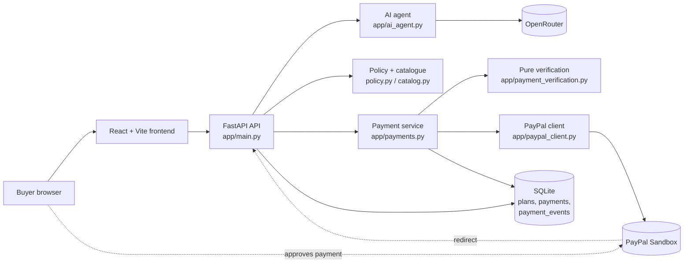
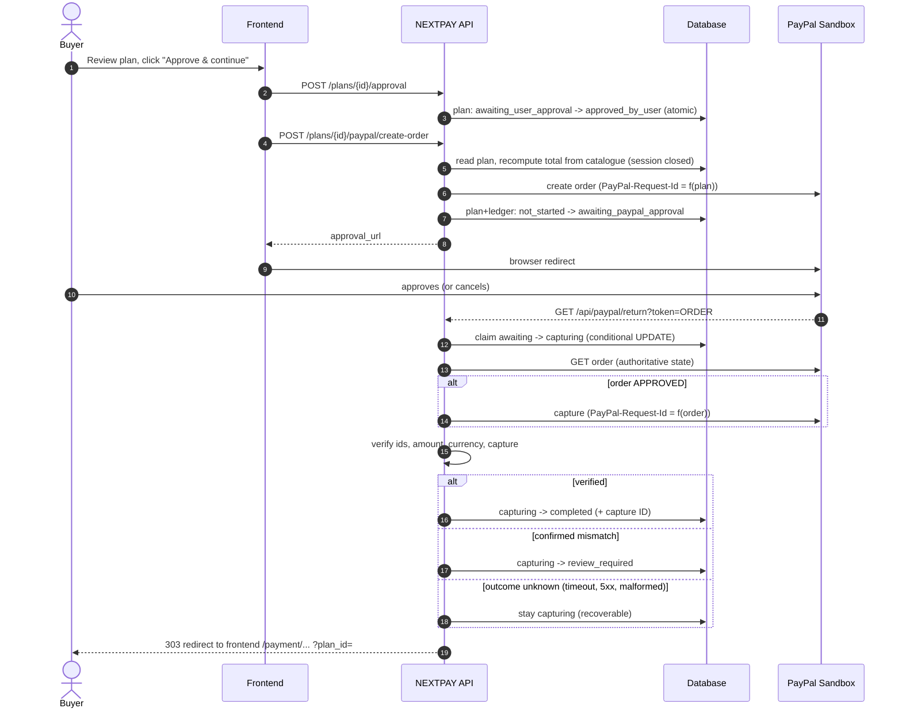

# NEXTPAY

**AI-assisted shopping with a human in control of the money.**
Describe what you want in plain English, review a server-validated purchase plan, approve it explicitly, and pay through **PayPal Sandbox**. Every payment is verified against PayPal's own records and written to an audit ledger.

> **Sandbox only.** NEXTPAY refuses to talk to any PayPal host other than `api-m.sandbox.paypal.com`. No real money can move. Product data is fictional sample data.

---

## 1. Problem

AI shopping agents are convenient but risky: a model can misread a budget, invent a price, or "buy" something the user never agreed to. Payment flows add a second problem: networks fail, callbacks arrive twice, and a timeout leaves the merchant unsure whether the customer was charged.

## 2. Solution

NEXTPAY separates **what the AI may do** from **what only the server may decide**:

- The AI only turns text into a structured *intent* (category, budget). It never sets a price, creates an order, or approves anything.
- Prices, totals, quantity limits and budgets are computed by the server from a trusted catalogue.
- Nothing is charged until the user explicitly approves a specific plan.
- After PayPal checkout, the server re-checks PayPal's authoritative order data before marking anything paid, and never guesses when the outcome is unknown.

## 3. Features

| Area | What exists |
|---|---|
| AI intent parsing | OpenRouter (`openrouter/free`) → validated JSON intent; model output cannot remove the approval requirement |
| Recommendations | Filtered from the server catalogue by category and budget |
| Purchase plans | Quantity 1-5, budget cap, server-calculated total, persisted in SQLite |
| Approval | Explicit approve/reject; atomic, cannot be approved twice |
| PayPal Sandbox | Order creation, approval redirect, capture, cancel handling |
| Verification | Order ID, purchase-unit count, `reference_id`, `custom_id`, capture ID/status, currency, exact amount, local ledger |
| Recovery | Idempotent create/capture, authoritative order lookup, stale-claim takeover, manual "check status" |
| Audit trail | `payment_events` table plus ledger endpoint |
| Frontend | React fintech UI, loading/error/empty states, duplicate-submit protection, payment status pages |

## 4. Tech stack

Python · FastAPI · SQLAlchemy · SQLite · httpx · React 19 · Vite · Tailwind CSS 4 · lucide-react · OpenRouter · PayPal Sandbox REST API · pytest.

## 5. Architecture



Responsibilities are deliberately separate: `main.py` only handles HTTP; `payments.py` owns every payment state change; `payment_verification.py` has no I/O so every rule is unit-tested; `paypal_client.py` is the only code that talks to PayPal.

## 6. AI integration

`POST /api/agent/recommend` sends the user's message to OpenRouter and requires a JSON object (`AgentIntent`: category, budget, preferences, clarification flags). The response is validated with Pydantic, a budget above the demo limit is rejected, and `requires_confirmation` is forced to `true` in code. If the AI is unavailable the API returns `503`; it never fabricates recommendations. Products shown always come from the server catalogue.

## 7. Payment workflow



### Payment state machine

Plan (`payment_status`) and ledger (`status`) always carry the same value and change together in one transaction.

```mermaid
stateDiagram-v2
    [*] --> not_started
    not_started --> awaiting_paypal_approval: order created
    awaiting_paypal_approval --> capturing: return callback claims it
    awaiting_paypal_approval --> cancelled_by_buyer: buyer cancels
    capturing --> completed: PayPal data verified
    capturing --> review_required: confirmed mismatch
    capturing --> failed: PayPal declined / voided
    capturing --> awaiting_paypal_approval: buyer had not approved
    capturing --> capturing: unknown outcome (stay; reconcile later)
    completed --> [*]
    cancelled_by_buyer --> [*]
    review_required --> [*]
    failed --> [*]
```



| Situation | Result |
|---|---|
| Two callbacks at once | One wins the conditional UPDATE; the other is told "processing" |
| Refresh / duplicate return | `completed` is returned idempotently; PayPal is not called again |
| Timeout, 5xx, network drop, malformed reply, auth error | Stays `capturing`; **never** reported as failed |
| Server dies after PayPal captured | Next callback sees the order `COMPLETED` at PayPal and records it without capturing again |
| Claim older than `CAPTURE_LEASE_SECONDS` | Another callback may take over (compare-and-swap) and reconcile |
| Wrong amount/currency/IDs, no or multiple captures | `review_required` (manual); capture is not attempted if the approved order already mismatches |
| `INSTRUMENT_DECLINED`, voided order | `failed` |
| Buyer never completed approval | Claim released back to `awaiting_paypal_approval` |

`review_required` and `failed` are terminal in code and are resolved by a human.

## 8. Security measures

See [`docs/SECURITY.md`](docs/SECURITY.md) for the full audit. Highlights: server-side prices and budgets; sandbox host allow-list; secrets only in environment variables (`.env` is git-ignored, none in the frontend); idempotency keys for create and capture; fixed-path redirects to the configured frontend only; PayPal approval URL must be `https://*.paypal.com`; order IDs validated before they reach a URL path; strict CORS; no credentials or PayPal payloads in logs.

## 9. Installation

Requirements: Python 3.11+ and Node.js 20+.

```powershell
# from the project root (PowerShell)
python -m venv .venv
.\.venv\Scripts\Activate.ps1
python -m pip install -r requirements.txt

cd frontend
npm install
cd ..
```

## 10. Environment configuration

```powershell
Copy-Item .env.example .env                       # then edit .env
Copy-Item frontend\.env.example frontend\.env.local
```

| Variable | Purpose | Default |
|---|---|---|
| `PAYPAL_CLIENT_ID`, `PAYPAL_CLIENT_SECRET` | Sandbox REST app credentials | *(required for checkout)* |
| `PAYPAL_BASE_URL` | Must be `https://api-m.sandbox.paypal.com` | same |
| `OPENROUTER_API_KEY`, `OPENROUTER_MODEL` | AI intent parsing | model `openrouter/free` |
| `BACKEND_URL` | Public API URL PayPal redirects to | `http://127.0.0.1:8000` |
| `FRONTEND_URL` | Where the API sends the buyer back | `http://localhost:5173` |
| `PAYPAL_RETURN_URL`, `PAYPAL_CANCEL_URL` | Optional overrides | `<BACKEND_URL>/api/paypal/return` / `/cancel` |
| `CORS_ORIGINS` | Comma-separated allowed origins | `FRONTEND_URL` |
| `DATABASE_URL` | SQLAlchemy URL | `sqlite:///./nextpay.db` |
| `CAPTURE_LEASE_SECONDS` | How long a `capturing` claim blocks other callbacks | `60` |
| `APP_ENV` | `production` hides `/api/paypal/test-auth` and tightens CORS defaults | `development` |
| `VITE_API_URL` (frontend) | API base URL used by the browser | `http://127.0.0.1:8000` |

## 11-12. Running

```powershell
# terminal 1 - backend  (API docs: http://127.0.0.1:8000/docs)
python -m uvicorn app.main:app --reload

# terminal 2 - frontend (http://localhost:5173)
cd frontend
npm run dev
```

## 13. Automated tests

```powershell
python -m pytest -q
cd frontend; npm run build; npm run lint
```

Tests use a temporary SQLite file, dummy credentials, and a guard that blocks outbound network connections, so they never touch `nextpay.db`, PayPal or OpenRouter.

| File | Needs FastAPI | Covers |
|---|---|---|
| `test_payment_verification.py` | no | every verification rule |
| `test_paypal_client.py` | no | HTTP error taxonomy, idempotency keys, URL/ID safety, log hygiene |
| `test_payment_service.py` | no | state machine, recovery, races, ledger consistency, cancellation, order creation |
| `test_payments.py`, `test_api.py`, `test_ai_agent.py` | yes | HTTP contract and redirects |

## 14. PayPal Sandbox setup

1. Sign in at <https://developer.paypal.com/dashboard/> and open **Apps & Credentials → Sandbox → Create App** (Merchant).
2. Copy the **Client ID** and **Secret** into `.env`.
3. Under **Testing tools → Sandbox accounts**, use (or create) a **Personal** account as the buyer; its sandbox email/password are used on PayPal's checkout page.
4. Check credentials: open `http://127.0.0.1:8000/api/paypal/test-auth` (development only).
5. Run the demo below with that buyer account. Capturing against Sandbox is free and fictional.

## 15. API endpoints

Interactive docs: `/docs`. All responses under `/api/` are `Cache-Control: no-store`.

| Method & path | Purpose | Notable responses |
|---|---|---|
| `GET /health` | Liveness | `200` |
| `GET /api/catalog` | Sample catalogue | `200` |
| `POST /api/agent/recommend` | AI intent → recommendations | `200` (`recommendations_ready` / `needs_clarification`), `503` AI unavailable |
| `POST /api/plans` | Create a plan (`product_id`, `quantity` 1-5, `budget_limit`, `goal`) | `201`, `422` policy violation |
| `GET /api/plans/{id}` | Plan + payment status | `200`, `404` |
| `POST /api/plans/{id}/approval` | `{ "approved": true/false }` | `200`, `409` already decided, `422` |
| `POST /api/plans/{id}/paypal/create-order` | Create PayPal order, returns `approval_url` | `200`, `403` not approved, `409` already started, `502/503` PayPal |
| `GET /api/paypal/return?token=…` | PayPal redirect target; captures and verifies | `303` to frontend (`/payment/success`, `/pending`, `/failure`) |
| `GET /api/paypal/cancel?plan_id=…[&token=…]` | Cancel redirect target | `303` to frontend |
| `POST /api/plans/{id}/paypal/reconcile` | Re-check a payment against PayPal | `200 {outcome, payment_status}` |
| `GET /api/plans/{id}/payment` | Ledger rows + audit events | `200`, `404` |
| `GET /api/paypal/test-auth` | Verify Sandbox credentials (hidden when `APP_ENV=production`) | `200`, `502` |

## 16. Known limitations

- No user accounts: the unguessable `plan_id` acts as the capability to view/continue a plan.
- No rate limiting; the AI endpoint can consume the free OpenRouter quota.
- One product per plan; fictional catalogue; USD only.
- No PayPal **webhooks** and no background reconciler: recovery happens on the return URL, on refresh, or via the "Check payment status" button.
- Refunds and disputes are not implemented.
- SQLite on a free host has an ephemeral disk; data resets on redeploy.
- No frontend unit/e2e tests; the UI was checked by build and server-render smoke test only (see below).
- A `review_required` payment has no admin UI: it is resolved directly in the database.
- Behaviour against the live PayPal Sandbox must still be verified by you (see "Evidence").

## 17. Future improvements

PayPal webhooks (`PAYMENT.CAPTURE.COMPLETED`) feeding the same reconciliation code; a background job that sweeps stale `capturing` rows; authentication and per-user plans; PostgreSQL; rate limiting; multi-item carts; refunds; a small admin view for `review_required`; Playwright end-to-end tests.

---

## Demo walkthrough

1. Start backend and frontend; open <http://localhost:5173>.
2. Enter: *"I need comfortable headphones for studying, under $70."* → the AI intent and one recommendation appear.
3. Select **Over-Ear Headphones**, set quantity 1, click **Review purchase** → server-validated total `$59.00`.
4. Show the guard: set the budget below the price → the server rejects it.
5. Click **Approve purchase & continue to PayPal** → PayPal Sandbox opens.
6. Log in with the sandbox buyer and approve → redirected to **Payment successful** with capture ID.
7. Open `http://127.0.0.1:8000/api/plans/<plan_id>/payment` → ledger and audit events.
8. Repeat and click **Cancel** on PayPal → **Checkout cancelled**; ledger shows `cancelled_by_buyer`.
9. Refresh the success page and the return URL → no second capture.

More submission material (description, slide outline, screenshot checklist): [`docs/SUBMISSION.md`](docs/SUBMISSION.md).

## Deployment (free tier, not done for you)

Nothing is deployed by this repository. `render.yaml` (API), `frontend/vercel.json` and `frontend/public/_redirects` (SPA routing) are prepared. You must create the accounts and services, set the secrets, and approve each step; see the checklist in [`docs/SUBMISSION.md`](docs/SUBMISSION.md). Check each provider's current free-tier terms yourself.
