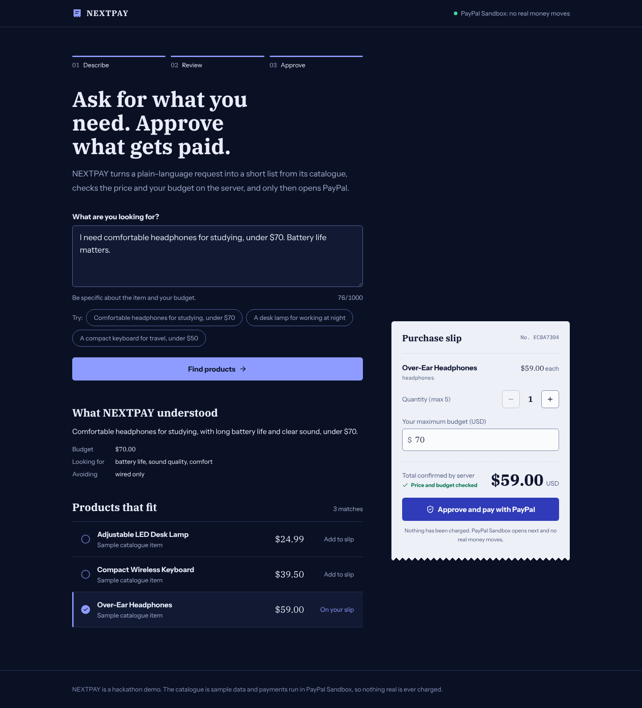

# NEXTPAY design



*Screenshots in this folder are real renders of the UI, produced with the API mocked (no PayPal, no OpenRouter). `before-desktop.png` is the previous design for comparison.*

## The idea

**The purchase is a paper slip lying on a dark navy desk.**

The page stays quiet and dark. The one bright, high-contrast object is the **purchase slip**: it starts as an empty dashed outline, prints in when you choose a product, shows an *estimated* total while you adjust quantity and budget, then shows the **server-confirmed** total before you approve. The result pages after PayPal are the same slip, so the success page is literally a receipt. A torn edge and a dashed rule are the only decoration.

Why this fits the product: NEXTPAY is about keeping a person in control of a payment. Making the thing you are about to pay for the most visible object on screen, and the only light one, puts the important moment in the right place.

## Layout

| Width | Layout |
|---|---|
| 1024px and up | Two columns. Left: progress, headline, request form, what the AI understood, product list. Right: the slip, `sticky`, so it stays in view while you scroll. |
| Below 1024px | One column. The slip follows the list and scrolls into view when a product is chosen. |

A three-segment tracker (**Describe, Review, Approve**) follows real state: `Review` once there are matches, `Approve` once the server has confirmed a plan.

## Type

| Role | Family | Why |
|---|---|---|
| Headlines, money | **IBM Plex Serif** (400, 700) | Sturdy and ledger-like; numerals read as an accounting document. Tabular figures keep columns aligned. |
| Interface text | **Instrument Sans** (400, 700) | Clean and humanist without being the usual default. |
| Slip references only | **IBM Plex Mono** (400) | Used for the slip number and SKU, the one place where a monospace is literally how a receipt looks. |

Only weights 400 and 700 exist, so the design uses only those, and `font-synthesis: none` stops browsers faking others. Fonts are **self-hosted** (`frontend/src/assets/fonts`, Latin subsets, about 112 KB in total), so the app needs no font CDN. All three families are SIL Open Font License 1.1; see `LICENSES.md` there.

## Colour (all tokens live in `frontend/src/index.css`)

Every text pairing below was computed from the actual CSS values and meets WCAG AA (4.5:1 for text, 3:1 for field borders and focus rings).

| Token | Value | Used for | Contrast |
|---|---|---|---|
| `canvas` | `#0b1124` | The desk (page background) | |
| `panel` | `#121a33` | Selected row, text area | |
| `line` | `#26305a` | Hairlines and dividers | |
| `line-strong` | `#5b68ad` | Field borders, radio rings | 3.6:1 on canvas |
| `fg` / `muted` / `faint` | `#e9edfb` / `#a3add1` / `#8893bc` | Text on the desk | 16.1 / 8.4 / 6.2:1 |
| `accent` | `#8e9cff` | Primary action, selection, focus | 7.5:1 |
| `paper` | `#edf0f7` | The slip | 16.4:1 against canvas |
| `ink` / `ink-muted` | `#0f1530` / `#4a5479` | Text on the slip | 15.7 / 6.5:1 |
| `indigo` | `#3b49d9` | Buttons on the slip | 6.7:1 (white text) |
| `ok` `warn` `bad` (+ `-ink`) | bright on the desk, dark on the slip | Status | 4.7 to 10.6:1 |

Status is never colour alone: each state also has an icon and a title.

## Motion

One moment: the slip prints in when it first fills (about 0.5 s). It is wrapped in `motion-safe:`, so people who prefer reduced motion get none. Everything else is instant.

## Accessibility checks that were run

Keyboard: skip link first, a 2 px focus ring on every control, and a darker indigo ring on the slip (the light accent would nearly vanish on paper). Every button and field has an accessible name or label, there is a single `h1`, product rows are real `<button aria-pressed>`, the quantity and budget controls are labelled, errors use `role="alert"`, and results are announced through a polite status region. The quantity buttons are 44 px on phones and 40 px on wider screens. No horizontal scroll at 320, 390, 768, 1024 or 1920 px.

## Files

```
frontend/src/index.css                 tokens, font faces, torn edge, animation
frontend/src/App.jsx                   shopping flow (state and handlers unchanged)
frontend/src/PaymentResult.jsx         result screens (logic unchanged)
frontend/src/components/chrome.jsx     wordmark, top bar, step tracker, footer
frontend/src/components/Slip.jsx       the purchase slip
frontend/src/components/Results.jsx    AI summary, clarification, product list
frontend/src/assets/fonts/             self-hosted fonts + licences
```

Payment logic, the plan access token, request sequencing, and every status string are untouched. The existing contract tests that scan these files still pass.

## Changing the look

Edit the `@theme` block in `frontend/src/index.css`: swapping `--color-accent`, the `--color-canvas` family or the font stacks re-skins the whole app without touching a component. Re-check contrast after changing any colour.

## What was verified, and what was not

Run for this design: the real Tailwind compiler and the real bundle, in Chromium, against a mocked API. That covered the complete purchase flow (including that the plan token is sent on exactly the protected calls and not on plan creation), the redirect to PayPal Sandbox, the return from PayPal, every payment state, polling and the manual re-check, fonts loading, sticky behaviour, reduced motion, overflow at five widths, keyboard focus, and accessible names.

**Not run:** `npm run build` and `npm run lint` (they need native Windows binaries), and anything against live PayPal. Please run `npm run build` and `npm run lint` on your machine.
